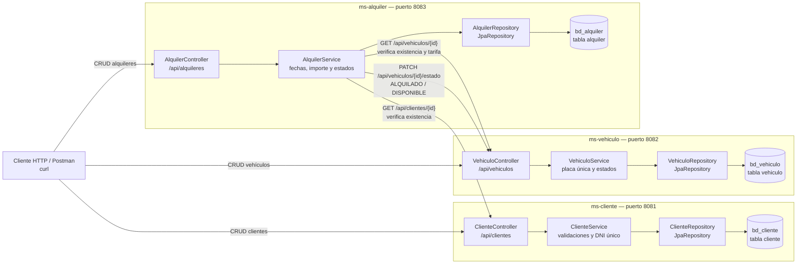
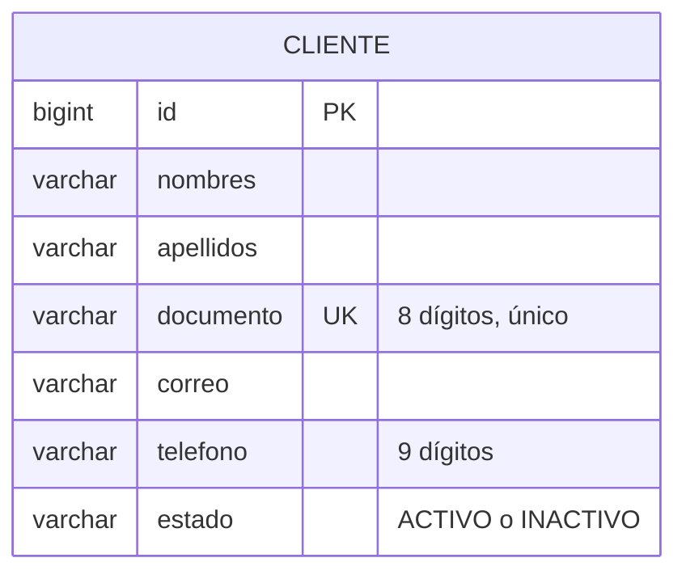
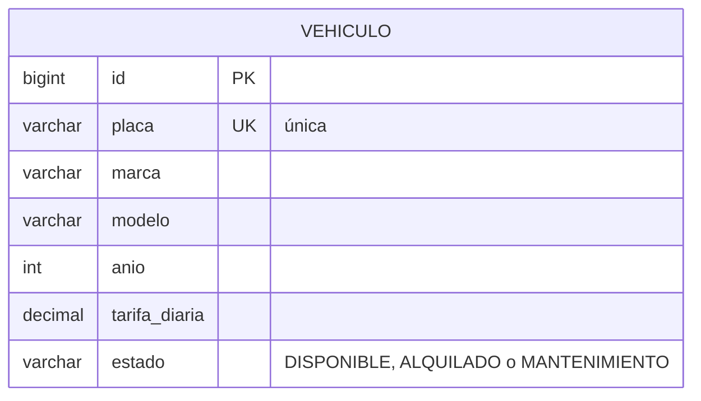
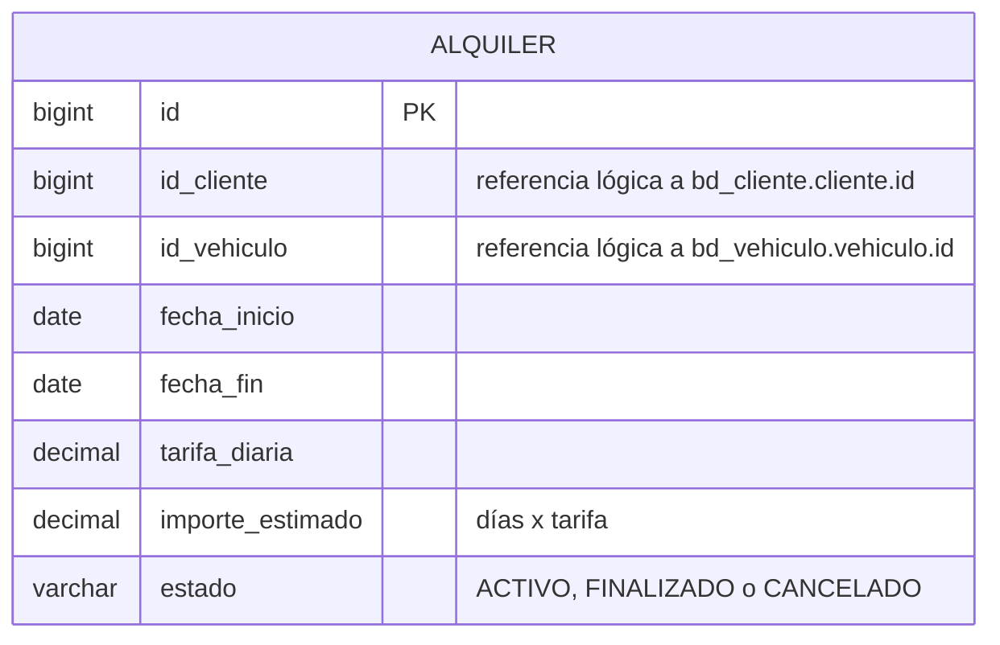
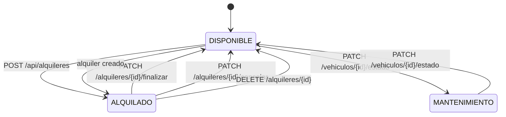
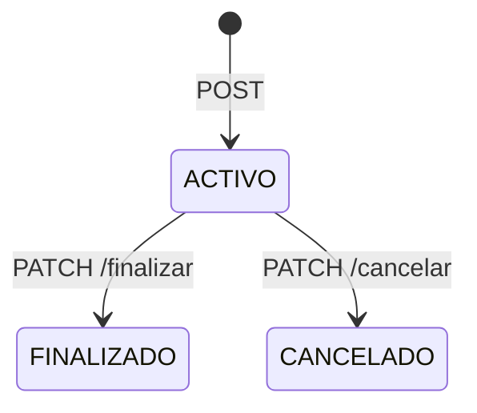
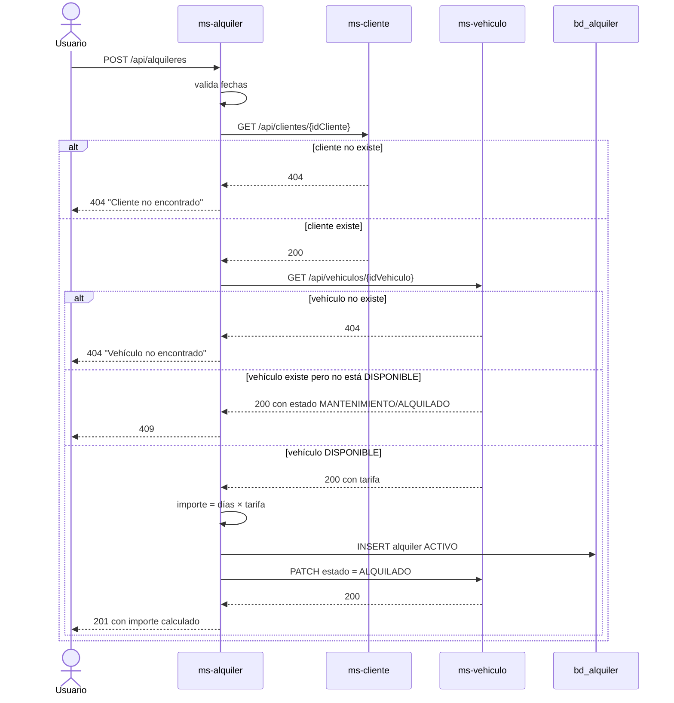

# Diagramas del Laboratorio 11

## 1. Arquitectura de microservicios

**Responsabilidades y límites:**

| Servicio | Responsabilidad | Datos que posee | No posee |
|---|---|---|---|
| ms-cliente | Datos personales y estado del cliente | `bd_cliente.cliente` | Vehículos ni alquileres |
| ms-vehiculo | Catálogo, tarifa y estado del vehículo | `bd_vehiculo.vehiculo` | Clientes ni alquileres |
| ms-alquiler | Contrato de alquiler y cálculo del importe | `bd_alquiler.alquiler` | Datos personales ni datos del vehículo |

La comunicación es **solo por HTTP con IDs**. No hay llaves foráneas entre las tres
bases y no existe una tabla compartida.

---

## 2. Diagrama ER — bd_cliente

- `id` es `BIGINT AUTO_INCREMENT`.
- `documento` tiene índice `UNIQUE` (`uk_cliente_documento`).
- `estado` se guarda como `VARCHAR(20)`.

---

## 3. Diagrama ER — bd_vehiculo

- `placa` tiene índice `UNIQUE` (`uk_vehiculo_placa`).
- `tarifa_diaria` es `DECIMAL(10,2)`.
- `estado` es `VARCHAR(20)` y se indexa para consultas por disponibilidad.

---

## 4. Diagrama ER — bd_alquiler

- **No hay FK** hacia `bd_cliente` ni `bd_vehiculo`: son bases distintas.
- `id_cliente` e `id_vehiculo` son referencias lógicas que se validan por HTTP antes
  de guardar.
- `importe_estimado` es `DECIMAL(10,2)` y lo calcula `AlquilerService`.

---

## 5. Flujo de estados entre alquiler y vehículo

El estado del alquiler también cambia:

---

## 6. Secuencia de creación de un alquiler

Si `ms-cliente` o `ms-vehiculo` no están disponibles, el `RestClient` lanza una
`ExternalServiceException` y el handler responde **503**.
